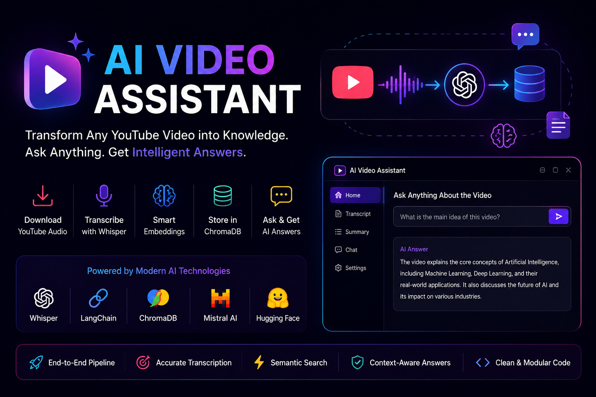
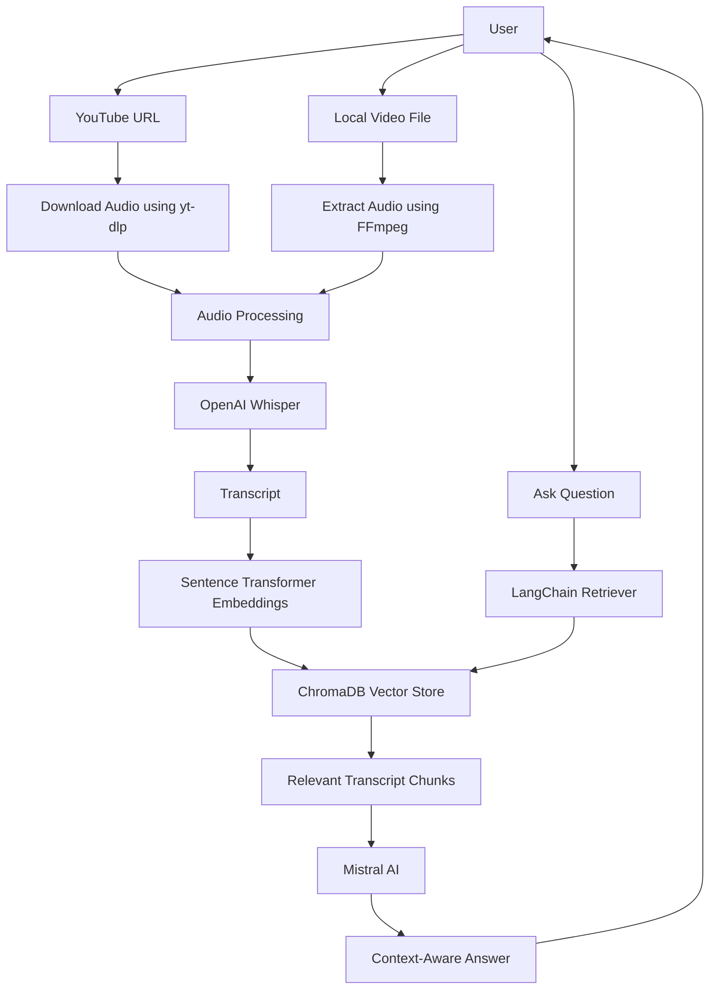
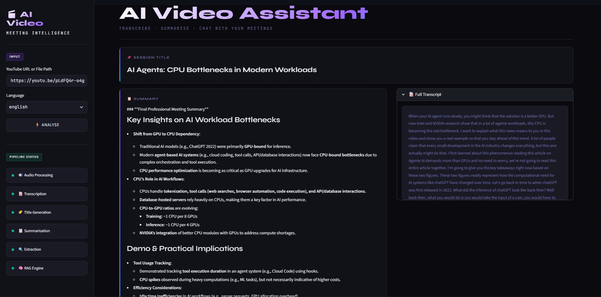
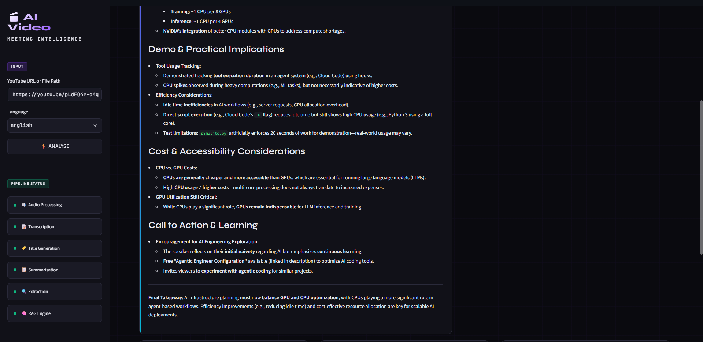
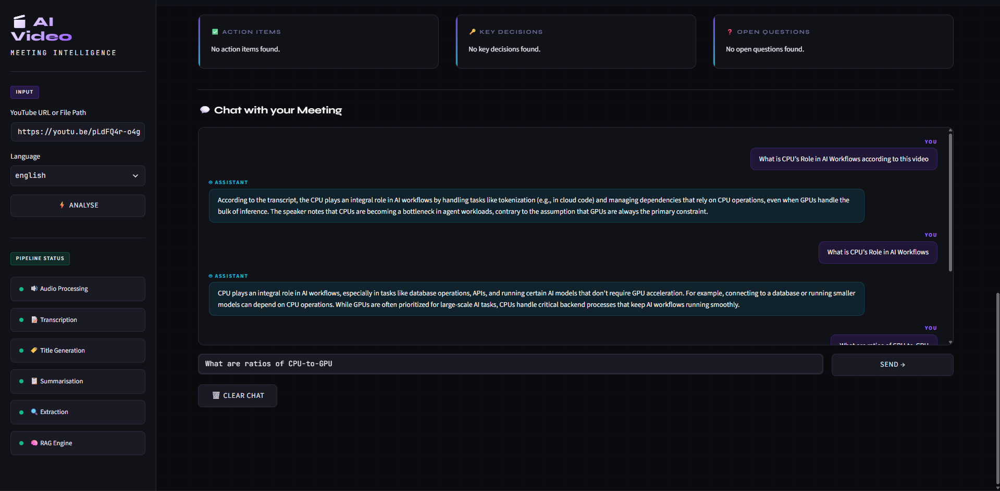
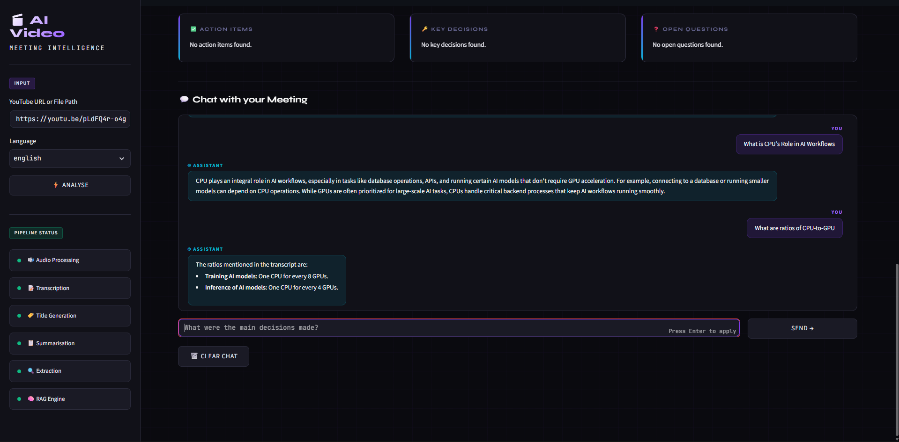

<p align="center">
  
</p>

<h1 align="center">🎥 AI Video Assistant</h1>

<p align="center">
Transform <strong>YouTube videos</strong> and <strong>local video files</strong> into intelligent, searchable knowledge using <strong>OpenAI Whisper</strong>, <strong>LangChain</strong>, <strong>ChromaDB</strong>, and <strong>Mistral AI</strong>.
</p>

<p align="center">


</p>

---

# 📌 Overview

AI Video Assistant is an end-to-end **Retrieval-Augmented Generation (RAG)** application that transforms **YouTube videos** and **local video files** into searchable knowledge.

The application automatically extracts audio from a YouTube URL or a local video file, transcribes speech using **OpenAI Whisper**, generates semantic embeddings with **Sentence Transformers**, stores them in **ChromaDB**, and enables intelligent question answering using **LangChain** and **Mistral AI**.

Instead of manually watching long videos, users can quickly:

- Read AI-generated summaries
- View complete transcripts
- Extract action items
- Identify key decisions
- Find open questions
- Chat with the video using natural language

---

# ✨ Features

- 🎥 Analyze YouTube videos using a URL
- 📁 Analyze local video files (MP4, AVI, MOV, MKV, etc.)
- 🎙️ Automatic speech-to-text transcription using OpenAI Whisper
- ✂️ Audio extraction and preprocessing
- 📝 AI-generated structured summaries
- 🏷️ Automatic title generation
- 📌 Extract action items
- 🔑 Identify key decisions
- ❓ Detect open questions
- 🧠 Generate semantic embeddings
- 📚 Store embeddings in ChromaDB
- 🔍 Retrieval-Augmented Generation (RAG)
- 💬 Context-aware conversational AI
- 🎨 Interactive Streamlit interface

---

# 🏗️ System Architecture



---

# ⚙️ Workflow

```
                 User Input
                     │
        ┌────────────┴────────────┐
        │                         │
        ▼                         ▼
  YouTube URL              Local Video File
        │                         │
        ▼                         ▼
 Download Audio            Extract Audio
      yt-dlp                 FFmpeg
        │                         │
        └────────────┬────────────┘
                     ▼
            Audio Processing
                     │
                     ▼
          Whisper Transcription
                     │
                     ▼
               Transcript
                     │
                     ▼
        Sentence Transformer
             Embeddings
                     │
                     ▼
              ChromaDB
                     │
                     ▼
            User Question
                     │
                     ▼
          Semantic Retrieval
                     │
                     ▼
         Relevant Transcript
                     │
                     ▼
             Mistral AI LLM
                     │
                     ▼
         Context-Aware Answer
```

---

# 🛠️ Tech Stack

| Category | Technologies |
|----------|--------------|
| Programming Language | Python 3.11 |
| Frontend | Streamlit |
| Speech Recognition | OpenAI Whisper |
| Audio Processing | yt-dlp, FFmpeg, Pydub |
| Embeddings | Sentence Transformers |
| Vector Database | ChromaDB |
| RAG Framework | LangChain |
| LLM | Mistral AI |
| Deep Learning | PyTorch |

---

# 📂 Project Structure

```
AI-Video-Assistant/
│
├── assets/
│   ├── banner.png
│   ├── dashboard.png
│   ├── summary.png
│   ├── chat.png
│   └── rag_answer.png
│
├── core/
│
├── utils/
│
├── downloads/
│
├── vector_db/
│
├── app.py
├── main.py
├── requirements.txt
├── .env.example
└── README.md
```

---

# 📸 Screenshots

## 🏠 Dashboard

Analyze a **YouTube URL** or a **local video file**.

The application automatically:

- Downloads or extracts audio
- Transcribes speech
- Generates summaries
- Extracts insights
- Builds a searchable knowledge base



---

## 📝 AI Summary

Generate professional summaries containing:

- Key insights
- Important concepts
- Practical implications
- Final takeaways



---

## 💬 Chat with the Video

Interact with your video using natural language.

The application retrieves relevant transcript chunks from ChromaDB before generating accurate answers with Mistral AI.



---

## 🔍 Retrieval-Augmented Generation (RAG)

Every answer is grounded in the video's transcript, providing context-aware and reliable responses.



---

# 🚀 Installation

## 1. Clone Repository

```bash
git clone https://github.com/yourusername/AI-Video-Assistant.git

cd AI-Video-Assistant
```

---

## 2. Create Virtual Environment

Windows

```bash
python -m venv venv

venv\Scripts\activate
```

Linux / macOS

```bash
python3 -m venv venv

source venv/bin/activate
```

---

## 3. Install Dependencies

```bash
pip install -r requirements.txt
```

---

## 4. Install FFmpeg

Download and install FFmpeg.

Verify installation:

```bash
ffmpeg -version
```

---

## 5. Configure Environment Variables

Create a `.env` file.

```env
MISTRAL_API_KEY=your_api_key

SARVAM_API_KEY=your_api_key
```

---

# ▶️ Run the Application

```bash
streamlit run app.py
```

---

# 💡 Example Usage

### Analyze a YouTube Video

```
https://www.youtube.com/watch?v=XXXXXXXX
```

---

### Analyze a Local Video

Windows

```
C:\Users\Heet\Videos\lecture.mp4
```

Linux/macOS

```
/home/user/videos/lecture.mp4
```

---

Click **Analyze**.

The application will automatically:

- Extract audio
- Generate transcript
- Create AI summary
- Extract action items
- Identify key decisions
- Detect open questions
- Build a vector database
- Enable conversational AI

---

# 🌟 Future Improvements

- 🌍 Multi-language transcription
- 🎤 Speaker diarization
- ⏱️ Timestamp-based transcript navigation
- 📄 PDF summary export
- 💾 Download transcript and chat history
- 🤖 Multiple LLM support
- ☁️ Cloud deployment
- 🔐 User authentication
- 📺 Playlist and batch video processing
- 📱 Responsive mobile interface

---

# 🤝 Contributing

Contributions are welcome!

1. Fork the repository

2. Create a new branch

```bash
git checkout -b feature-name
```

3. Commit your changes

```bash
git commit -m "Add new feature"
```

4. Push your branch

```bash
git push origin feature-name
```

5. Open a Pull Request

---

# 👨‍💻 Author

**Heet Patel**

- GitHub: https://github.com/heet88
- LinkedIn: https://linkedin.com/in/heet247

---

<p align="center">

⭐ If you found this project useful, please consider giving it a star!

</p>